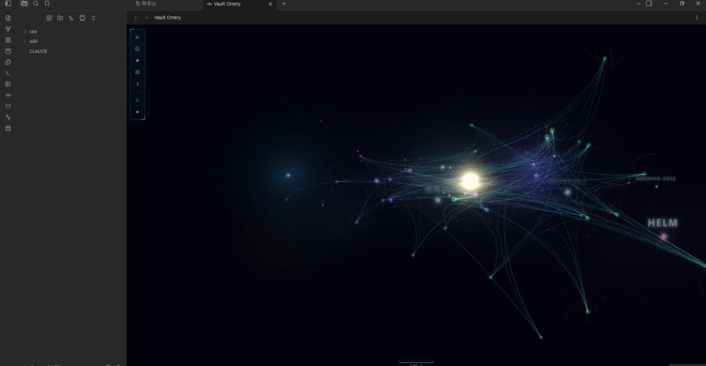
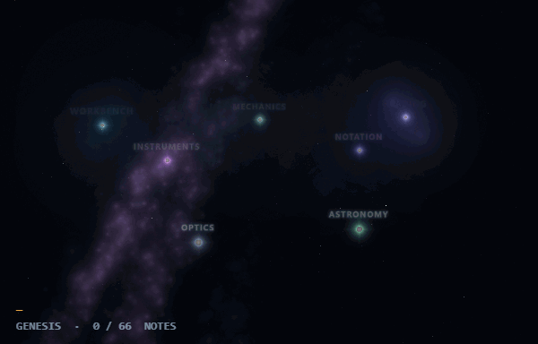
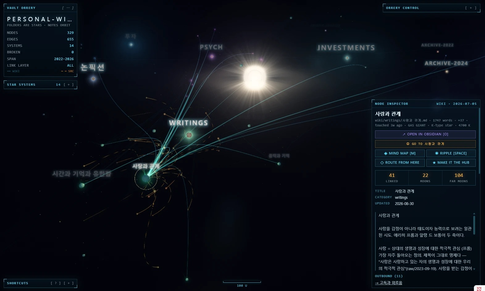
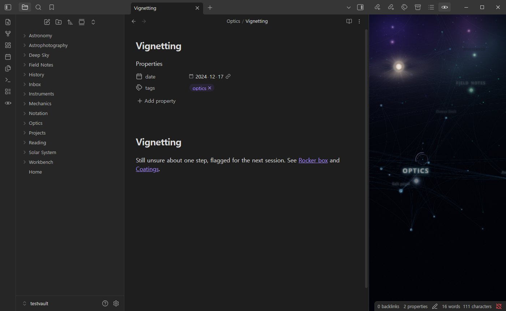
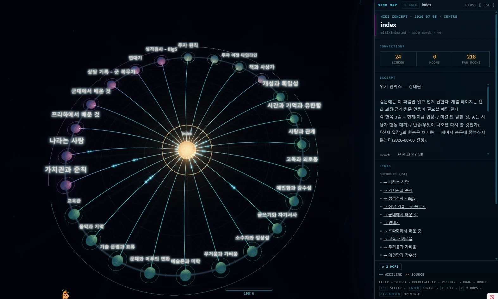

# Vault Orrery

**See your Obsidian vault as a living star system — and replay how it grew.**
Folders are stars, notes are the planets orbiting them, and every body on
screen is a note you can be reading a second later. Keep a small one turning
in your sidebar while you write, and share yours as a photo card. Works
offline.

  <a href="https://elliott-json-park.github.io/obsidian-vault-orrery/"><b>▶ Try it in your browser — no install, nothing uploaded</b></a>
  &nbsp;·&nbsp;
  <a href="https://obsidian.md/plugins?id=vault-orrery"><b>Install in Obsidian</b></a>

The demo is the same engine the plugin is built from. It opens on a sample
vault; drop a folder of markdown on it and it draws yours instead. The folder
is read in the browser and the page makes no network requests of any kind.

---

## What makes it different

**1 · Genesis replays your vault's history.** Press `G` and the cosmos rewinds
to empty space, then condenses forward to today, note by note, in the order you
actually wrote them. It is not an animation of the finished graph — it is the
vault's own history, and you can scrub it.

**2 · Folders are star systems, not another colour of dot.** Each folder is a
lit system with its notes in orbit round its star, so the shape of the vault is
the shape of the picture: a crowded folder looks crowded, and an orphaned note
sits out on its own.

**3 · It is wired into the editor.** Click a planet and its note is in the
inspector — properties, tags, an excerpt, every link and backlink — with the
buttons to open it, map it or trace a route from it right under its name.
Ctrl/Cmd-click opens the note *beside* the orrery, the note you are editing
carries its own beacon, and *Show in Vault Orrery* is on every note's context
menu.

**4 · It stays open beside your work.** A mini orrery lives in the right
sidebar: the whole vault, turning slowly about the note you are editing, with
a ring of light on that note. Click a planet to open it. It draws twenty
frames a second with no panels and no sound, and stops while the sidebar is
closed — and the full view drops to thirty frames a second whenever you leave
it alone, so neither one is something you have to remember to close.

**5 · It makes something worth posting.** Press `C` for a 9:16 photo card:
your vault's own sky in the frame, its name above, and up to six numbers
below — how old the vault is, how many notes and links, its biggest system,
its most cited note, its longest streak, a constellation name of its own.
Turn and zoom inside the frame, then save a 1080 × 1920 image or record
fifteen seconds of whatever you do with the camera as an MP4.

---

## Getting started

1. **Install** — Settings → Community plugins → Browse → *Vault Orrery*.
2. **Open it** — the orbit icon in the ribbon, or *Vault Orrery: Open* in the
   command palette. A card names the four moves that are enough to get going.
   The mini orrery is already in your right sidebar.
3. **Explore** — drag to orbit, scroll to zoom, click a planet to read it,
   double-click for its mind map, and press `G` to watch the vault form.

If a large vault feels slow, press **FAST** at the top of the controls (⚙ on
the rail).
The first time a big vault opens on a machine that is struggling, the orrery
does that for you and says so.

---

## What it does

The tools sit on a thin rail at the left edge and open as drawers, so the
frame is all sky until you ask for one: ⌕ search, ◎ the vault's numbers,
✦ star systems, ⚙ controls, ? shortcuts, ◌ Genesis and ● the photo card.
**PIN** keeps a drawer open beside the next; a click on the sky closes the
rest. The inspector appears when you select a note.

- **Mini orrery** — the same cosmos in the right sidebar, centred on the note
  you are editing. *Open the mini orrery in the sidebar* brings it back.
- **Photo card** — `C` — a 9:16 image or a fifteen-second MP4 of your vault,
  with the stats you choose.
- **Mind map** — `M` or double-click — one note's neighbourhood, two hops out,
  in place, with a reading rail beside it.
- **Search** — `/` — notes, controls and actions in one box. Front-matter
  properties are searchable, so `status: blocked` is a thing you can look for.
- **Route** — pick two notes and the shortest way between them lights up.
- **Broken links**, counted in the status panel and named in the inspector.
  Click the count to keep only the notes carrying them.
- **Ripple** — `SPACE` — a wave along the links from the selected note.
- **Poster** — `P` — a high-resolution PNG of the whole frame with no HUD.
- **Quality presets** — CINEMA · BALANCED · FAST — the eight light effects in
  one click, and every knob still there under ADVANCED.
- **The sky has events.** A comet lands on the note you just touched; a note
  deleted while you watch goes out as a supernova and says its name.
- **Ambient sound** — `U` — every note has a pitch; off until you ask.
- **한국어 · English · 日本語 · 中文**, switchable without reloading.

**The graph is Obsidian's own.** Links, backlinks and tags come from the index
Obsidian already keeps, so a link written through an alias resolves rather than
counting as broken, an embed counts as a link, and a `#tag` in a paragraph
counts alongside the ones in the front matter.

**The vault stays current.** Notes written, created, renamed or deleted while
the view is open re-derive the cosmos — camera and selection left where they
were, and no loading curtain over a view you are using.

---

## Controls

| | |
|---|---|
| `O` · ctrl/cmd-click | open the note in Obsidian |
| `/` | search |
| `M` · double-click | mind map |
| `G` | Genesis — play the vault's formation |
| `SPACE` | ripple from the selected note |
| `P` | save a poster (high-resolution PNG, no HUD) |
| `C` | photo card — 9:16 image or 15-second clip |
| `L` | cycle the link layer — ALL · WIKI · SOURCE · BRIDGE · OFF |
| `X` | the reference plane on the layout's own plane |
| `U` | ambient sound |
| `R` · `H` | reset view · hide HUD |
| `?` | the guide — every key above with a line on what it does |
| drag / wheel | orbit · zoom toward the cursor |
| right-drag · shift-drag | pan · move a node |

The first time a vault loads, a card names the four moves that are enough to
get going. Any key dismisses it. `?` — or the `[ ? ]` in the title bar of the
SHORTCUTS drawer — opens the full guide, which explains each of the above and
the three things that have no key: the broken-link filter, the route, and
BRIDGE. The four-move card is one click away at the bottom of it. Escape
closes an open drawer before anything else.

---

## Privacy, in one paragraph

**No network access at runtime. At all.** No server, no telemetry, no
analytics, no update check, no remote font, no CDN — the plugin makes zero
outbound requests, and `npm run check` is that claim automated over the built
bundle. It reads every markdown file in the vault, because the shape of the
vault *is* what is being drawn and a graph of a subset is a different vault's
picture. Reading goes through Obsidian's own cache, and your excluded-files
patterns are applied first, so a note you have hidden is never opened at all.

→ [The long version, and how to verify it](docs/privacy.md)

---

## Large vaults

If a big vault runs slowly, press **FAST** at the head of the controls drawer:
it turns the bloom, the lens, the halo and the sky's light off in one go, and
**CINEMA** puts them back. The first time a vault of 600 notes or more opens,
the orrery watches the frame rate for a few seconds and switches to FAST on its
own if the machine is plainly struggling — once, and with a line saying so.

The **MAX NODES** ceiling ships **off**: a cap that silently drops half a vault
is worse than a slow first minute, and the slider is right there. Rendering
stops entirely when you are not looking at the view, so an orrery in a
background tab costs nothing; a view on screen that nobody has touched for
twenty seconds draws at half rate, and the sidebar's mini orrery always draws
at a third.

→ [Performance in detail](docs/performance.md)

---

## Installation

**From the community plugin browser:** Settings → Community plugins → Browse →
"Vault Orrery" → Install.

**Manually:** copy `main.js`, `manifest.json` and `styles.css` from the release
into `<vault>/.obsidian/plugins/vault-orrery/`, then enable it in Settings.
Those three files are the whole plugin — three.js is bundled into `main.js`, so
nothing is fetched at runtime.

Desktop only: the renderer needs WebGL.

---

## Going deeper

- [How the picture is made](docs/rendering.md) — the grade, the glow, and the
  two knobs that decide how tightly the cosmos is packed.
- [The astronomy is not decoration](docs/astronomy.md) — what is actually
  simulated, and what is deliberately not to scale.
- [The hub, and hearing the vault](docs/features.md) — how the central star is
  chosen, and what the sound is playing.
- [Privacy and excluded files](docs/privacy.md)
- [Performance on large vaults](docs/performance.md)
- [Development](docs/development.md) — the engine is a single openable HTML
  page; this is how it becomes the plugin.
- [Contributing](CONTRIBUTING.md)
- [Changelog](CHANGELOG.md)

---

## License

MIT — see [LICENSE](LICENSE).

This plugin bundles **three.js** (MIT) and nothing else, and does not fetch it
from a network at runtime. Full notice and licence text in
[THIRD-PARTY-NOTICES.md](THIRD-PARTY-NOTICES.md).
