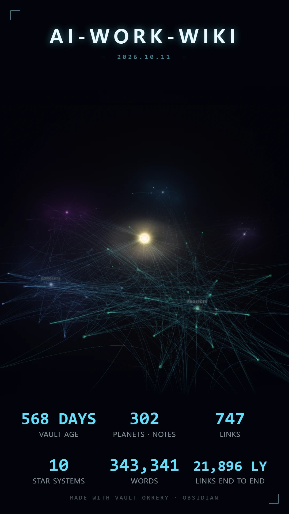

# Vault Orrery

**See your Obsidian vault as a living star system — and replay how it grew.**
Folders are stars, notes are the planets orbiting them, and every body on
screen is a note you can be reading a second later. Keep a small one turning
in your sidebar while you write, and share yours as a photo card. Works
offline.


<p align="center">
  <a href="https://elliott-json-park.github.io/obsidian-vault-orrery/"><b>▶ Try it in your browser — no install, nothing uploaded</b></a>
  &nbsp;·&nbsp;
  <a href="https://obsidian.md/plugins?id=vault-orrery"><b>Install in Obsidian</b></a>
  &nbsp;·&nbsp;
  <a href="#中文">中文</a> · <a href="#한국어">한국어</a>
</p>

The demo is the same engine the plugin is built from. It opens on a sample
vault; drop a folder of markdown on it and it draws yours instead. The folder
is read in the browser and the page makes no network requests of any kind.

---

## What makes it different

**1 · Genesis replays your vault's history.** Press `G` and the cosmos rewinds
to empty space, then condenses forward to today, note by note, in the order you
actually wrote them. It is not an animation of the finished graph — it is the
vault's own history, and you can scrub it.


**2 · Folders are star systems, not another colour of dot.** Each folder is a
lit system with its notes in orbit round its star, so the shape of the vault is
the shape of the picture: a crowded folder looks crowded, and an orphaned note
sits out on its own.

**3 · It is wired into the editor.** Click a planet and its note is in the
inspector — properties, tags, an excerpt, every link and backlink — with the
buttons to open it, map it or trace a route from it right under its name.
Ctrl/Cmd-click opens the note *beside* the orrery, the note you are editing
carries its own beacon, and *Show in Vault Orrery* is on every note's context
menu — the camera flies there from wherever it was, so you see where the note
sits in the vault. On Obsidian 1.10 and later every **Base** has an *Orrery*
view beside Table and Cards, which draws just the notes the Base selects.


**4 · It stays open beside your work.** A mini orrery lives in the right
sidebar: the whole vault, turning slowly about the note you are editing, with
a ring of light on that note and its name at the foot. Click a planet to open
it. It draws twenty frames a second at one pixel per pixel, with no panels and
no sound, and stops while the sidebar is closed — and the full view drops to
thirty frames a second whenever you leave it alone, so neither one is
something you have to remember to close.


**5 · It makes something worth posting.** Press `C` for a photo card: your
vault's own sky in the frame, its name above, and up to six numbers below —
how old the vault is, how many notes and links, its biggest system, its most
cited note, its longest streak, a constellation name of its own. 9:16 for a
story, 4:5 or 1:1 for a feed, 16:9 for a header. Turn and zoom inside the
frame, then save the image or record fifteen seconds of whatever you do with
the camera as an MP4. And for the note you are writing, *Insert the sky
report* puts the month's numbers in as a callout, with nothing drawn at all.

<p align="center">&nbsp;&nbsp;</p>

---

## Getting started

1. **Install** — Settings → Community plugins → Browse → *Vault Orrery*.
2. **Open it** — the orbit icon in the ribbon, or *Vault Orrery: Open* in the
   command palette. A card names the four moves that are enough to get going.
   The mini orrery is already in your right sidebar.
3. **Explore** — drag to orbit, scroll to zoom, click a planet to read it,
   double-click for its mind map, and press `G` to watch the vault form.

If a large vault feels slow, press **FAST** at the top of the controls (⚙ on
the rail).
The first time a big vault opens on a machine that is struggling, the orrery
does that for you and says so.

---

## What it does

The tools sit on a thin rail and open as drawers, so the frame is all sky
until you ask for one: search, the vault's numbers, star systems, controls,
shortcuts, Genesis and the photo card, drawn in Obsidian's own icons.
**PIN** keeps a drawer open beside the next; a click on the sky closes the
rest. Drag the rail by its grip to put it anywhere; double-click the grip to
send it back. The inspector appears when you select a note.

- **Mini orrery** — the same cosmos in the right sidebar, centred on the note
  you are editing, with its name at the foot. *Open the mini orrery in the
  sidebar* brings it back.
- **Orrery view for Bases** — on Obsidian 1.10 and later, in every Base's
  view menu. The notes the Base selects, and only those, drawn as their own
  cosmos; the Base's filters are how you carve the vault before it is drawn.
- **Sky report** — *Insert the sky report for this month*, from the palette,
  writes the month's numbers into the note at the cursor as a callout:
  planets, new and touched, links, systems, the biggest and the
  fastest-growing, the most cited note, rogue planets, broken links. *Copy
  the sky report* puts it on the clipboard instead.
- **Photo card** — `C` — an image or a fifteen-second MP4 of your vault, with
  the stats you choose, at 9:16, 4:5, 1:1 or 16:9.
- **Mind map** — `M` or double-click — one note's neighbourhood, two hops out,
  in place, with a reading rail beside it.
- **Search** — `/` — notes, controls and actions in one box. Front-matter
  properties are searchable, so `status: blocked` is a thing you can look for.
- **Route** — pick two notes and the shortest way between them lights up.
- **Broken links**, counted in the status panel and named in the inspector.
  Click the count to keep only the notes carrying them.
- **Ripple** — `SPACE` — a wave along the links from the selected note.
- **Poster** — `P` — a high-resolution PNG of the whole frame with no HUD.
- **Quality presets** — CINEMA · BALANCED · FAST — the eight light effects in
  one click, and every knob still there under ADVANCED.
- **The sky has events.** A comet lands on the note you just touched; a note
  deleted while you watch goes out as a supernova and says its name.
- **Sound** — `U` — every note has a pitch; off until you ask. The sound
  tab has five moods to try with one press, a live trace, and a **music
  box** that lets the orbits play the vault's notes as they go round.
- **A real night sky** — STARFIELD brings the stars up first, then the Milky
  Way and the gas, like walking away from town lights.
- **한국어 · English · 日本語 · 中文**, switchable without reloading.


**The graph is Obsidian's own.** Links, backlinks and tags come from the index
Obsidian already keeps, so a link written through an alias resolves rather than
counting as broken, an embed counts as a link, and a `#tag` in a paragraph
counts alongside the ones in the front matter.

**Moons are a note's sources.** A note that nothing links to and that links to
nothing is raw material: a clipping, a transcript, a scan. Name it in another
note's `sources` property (`source` and `출처` work too) and it orbits that note
as a moon:

```yaml
---
sources:
  - "[[Lecture 3 transcript]]"
  - "[[Smith 2021]]"
---
```

A raw note no one cites joins the archive, one system per year. If your vault
already keeps `raw/` and `wiki/` folders, the folders decide instead: anything
in `raw/` that a `wiki/` note links to or lists in `sources` is a moon of that
note. The inspector counts **MOONS**, a note's own, and **FAR MOONS**, the
moons of the notes it links to.

**The vault stays current.** Notes written, created, renamed or deleted while
the view is open re-derive the cosmos — camera and selection left where they
were, and no loading curtain over a view you are using.

---

## Controls

| | |
|---|---|
| `O` · ctrl/cmd-click | open the note in Obsidian |
| `/` | search |
| `M` · double-click | mind map |
| `G` | Genesis — play the vault's formation |
| `SPACE` | ripple from the selected note |
| `P` | save a poster (high-resolution PNG, no HUD) |
| `C` | photo card — image or 15-second clip, at 9:16 · 4:5 · 1:1 · 16:9 |
| `L` | cycle the link layer — ALL · WIKI · SOURCE · BRIDGE · OFF |
| `X` | the reference plane on the layout's own plane |
| `U` | ambient sound |
| `R` · `H` | reset view · hide HUD |
| `?` | the guide — every key above with a line on what it does |
| drag / wheel | orbit · zoom toward the cursor |
| right-drag · shift-drag | pan · move a node |

The first time a vault loads, a card names the four moves that are enough to
get going. Any key dismisses it. `?` — or the `[ ? ]` in the title bar of the
SHORTCUTS drawer — opens the full guide, which explains each of the above and
the three things that have no key: the broken-link filter, the route, and
BRIDGE. The four-move card is one click away at the bottom of it. Escape
closes an open drawer before anything else.

---

## Privacy, in one paragraph

**No network access at runtime. At all.** No server, no telemetry, no
analytics, no update check, no remote font, no CDN — the plugin makes zero
outbound requests. The shipped `main.js` has no `fetch`, `XMLHttpRequest`,
`WebSocket` or `atob` in it at all, and `npm run check` fails the build if one
ever appears. It reads every markdown file in the vault, because the shape of the
vault *is* what is being drawn and a graph of a subset is a different vault's
picture. Reading goes through Obsidian's own cache, and your excluded-files
patterns are applied first, so a note you have hidden is never opened at all.

→ [The long version, and how to verify it](docs/privacy.md)

---

## Large vaults

If a big vault runs slowly, press **FAST** at the head of the controls drawer:
it turns the bloom, the lens, the halo and the sky's light off in one go, and
**CINEMA** puts them back. The first time a vault of 600 notes or more opens,
the orrery watches the frame rate for a few seconds and switches to FAST on its
own if the machine is plainly struggling — once, and with a line saying so.

The **MAX NODES** ceiling ships **off**: a cap that silently drops half a vault
is worse than a slow first minute, and the slider is right there. Rendering
stops entirely when you are not looking at the view, so an orrery in a
background tab costs nothing; a view on screen that nobody has touched for
twenty seconds draws at half rate, and the sidebar's mini orrery always draws
at a third.

→ [Performance in detail](docs/performance.md)

---

## Installation

**From the community plugin browser:** Settings → Community plugins → Browse →
"Vault Orrery" → Install.

**Manually:** copy `main.js`, `manifest.json` and `styles.css` from the release
into `<vault>/.obsidian/plugins/vault-orrery/`, then enable it in Settings.
Those three files are the whole plugin — the parts of three.js it uses are
bundled into `main.js`, so nothing is fetched at runtime.

Desktop only: the renderer needs WebGL.

---

## Going deeper

- [How the picture is made](docs/rendering.md) — the grade, the glow, and the
  two knobs that decide how tightly the cosmos is packed.
- [The astronomy is not decoration](docs/astronomy.md) — what is actually
  simulated, and what is deliberately not to scale.
- [The hub, and hearing the vault](docs/features.md) — how the central star is
  chosen, and what the sound is playing.
- [Privacy and excluded files](docs/privacy.md)
- [Performance on large vaults](docs/performance.md)
- [Development](docs/development.md) — the engine is a single openable HTML
  page; this is how it becomes the plugin.
- [Contributing](CONTRIBUTING.md)
- [Changelog](CHANGELOG.md)

---

## 中文

**Vault Orrery** 把你的 Obsidian 库画成一个 3D 星系：每个文件夹是一颗恒星，笔记是绕着它运行的行星，链接在它们之间划出光弧。文件夹拥挤，画面就拥挤；没有人链接的笔记，会独自漂在外面。

- **Genesis（`G`）**：宇宙先回到一片虚空，再按照你真正写下笔记的顺序，一篇一篇重新形成。可以拖动时间轴。
- **检查器**：点击行星即可查看笔记的属性、摘要、链接和反向链接；Ctrl/Cmd 点击在旁边打开笔记。
- **思维导图（`M` 或双击）**：一篇笔记两跳以内的邻居，旁边附阅读栏。
- **路径**：选两篇笔记，点亮它们之间最短的路线。坏链接会被统计并可筛选。
- **侧边栏迷你星系**：以你正在编辑的笔记为中心。
- **海报（`P`）与照片卡（`C`）**：高清 PNG，或 9:16 · 4:5 · 1:1 · 16:9 图片 / 15 秒 MP4，方便分享。
- **Bases 视图**（Obsidian 1.10+）：在任意 Base 的视图菜单里选 Orrery，只画该 Base 筛出的笔记。**星空报告**：一条命令把本月的数字写进正在写的笔记。
- 界面支持 中文 · English · 한국어 · 日本語，可随时切换。
- **完全离线**：不发出任何网络请求，没有遥测，没有 CDN。仅限桌面端（需要 WebGL）。

**[▶ 在浏览器中试用，无需安装，什么都不会上传](https://elliott-json-park.github.io/obsidian-vault-orrery/)** · 安装：设置 → 第三方插件 → 浏览 → 搜索 “Vault Orrery”

## 한국어

**Vault Orrery**는 옵시디언 볼트를 3D 은하로 그립니다. 폴더는 항성, 노트는 그 둘레를 도는 행성, 링크는 그 사이를 잇는 빛줄기입니다. 붐비는 폴더는 붐벼 보이고, 아무도 링크하지 않는 노트는 바깥에 혼자 떠 있습니다.

- **Genesis(`G`)**: 우주가 빈 공간으로 돌아갔다가, 실제로 노트를 쓴 순서대로 하나씩 다시 생겨납니다. 시간 축을 끌어 앞뒤로 볼 수 있습니다.
- **인스펙터**: 행성을 누르면 속성·발췌·링크·백링크가 보이고, Ctrl/Cmd 클릭으로 옆에 노트를 엽니다.
- **마인드맵(`M` 또는 더블클릭)**, **두 노트 사이 최단 경로**, **깨진 링크 필터**, 사이드바의 **미니 오러리**.
- **포스터(`P`)와 포토 카드(`C`)**: 고해상도 PNG, 9:16 · 4:5 · 1:1 · 16:9 이미지나 15초 MP4로 공유할 수 있습니다.
- **Bases 뷰**(옵시디언 1.10 이상): 아무 Base의 뷰 메뉴에서 Orrery를 고르면 그 Base가 고른 노트만 우주로 그립니다. **하늘 보고서**: 명령 하나로 이번 달 숫자를 쓰고 있는 노트에 콜아웃으로 넣습니다.
- 네트워크 요청이 전혀 없습니다. 데스크톱 전용(WebGL).

**[▶ 설치 없이 브라우저에서 써 보기](https://elliott-json-park.github.io/obsidian-vault-orrery/)** · 설치: 설정 → 커뮤니티 플러그인 → 찾아보기 → “Vault Orrery”

---

## More from the same author

- **[Vault Pet](https://community.obsidian.md/plugins/vault-pet)**: a pixel cat that lives at the bottom of your workspace and levels up as you write.
- **[Class Timetable](https://community.obsidian.md/plugins/class-timetable)**: a weekly class timetable for students, with each class's lecture notes one click away. Desktop and mobile.
- **[Tag Graph](https://community.obsidian.md/plugins/tag-graph)**: a graph view for Bases where tags, folders and properties become hubs. Tag, retag and merge by dragging.
- **[Download Pulse](https://community.obsidian.md/plugins/plugin-pulse)**: download stats for plugin authors: every plugin's downloads, rank and milestones in one dashboard.

## License

MIT — see [LICENSE](LICENSE).

This plugin bundles **three.js** (MIT) and nothing else, and does not fetch it
from a network at runtime. Full notice and licence text in
[THIRD-PARTY-NOTICES.md](THIRD-PARTY-NOTICES.md).
